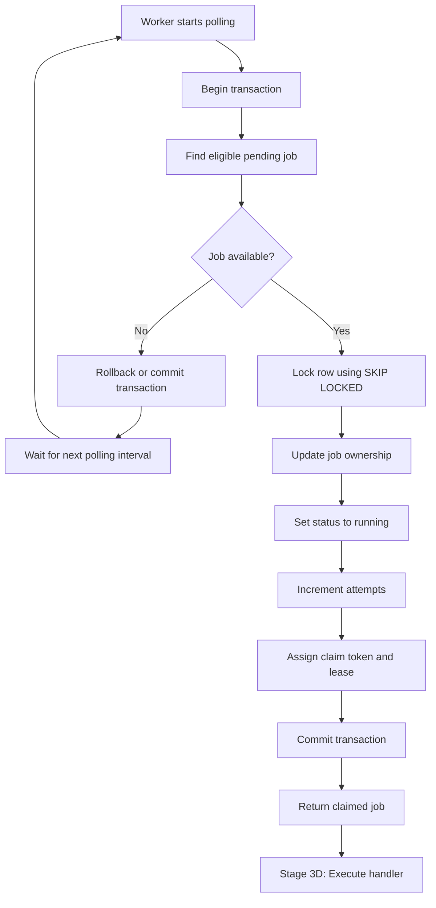

# Stage 3B — PostgreSQL Job Claiming

**Project:** PulseQueue  
**Milestone:** Stage 3 — Background Worker Engine  
**Phase:** 3B — PostgreSQL Job Claiming  
**Status:** Planned  
**Prerequisite:** Stage 3A — Worker Engine Architecture  
**Database:** PostgreSQL  
**Backend:** Go  
**Database Driver:** pgx/v5

---

# 1. Introduction

## 1.1 Purpose

Stage 3B introduces the database-level job claiming mechanism required by PulseQueue's background worker engine.

The purpose of this phase is to allow multiple independent worker processes to retrieve and claim pending jobs safely without processing the same job simultaneously.

PostgreSQL will act as the coordination mechanism between worker processes.

The implementation will use:

- PostgreSQL transactions.
- Row-level locking.
- `SELECT ... FOR UPDATE SKIP LOCKED`.
- Worker ownership information.
- Unique claim tokens.
- Lease expiration timestamps.

This phase focuses on safely claiming jobs and establishing ownership. Actual job handler execution, automatic retries, and full worker lifecycle management will be implemented in subsequent phases.

## 1.2 Background

Currently, PulseQueue supports:

- Job creation.
- Job retrieval.
- Job listing.
- Job filtering and pagination.
- Job cancellation.
- PostgreSQL persistence.
- React-based job management dashboard.

However, jobs remain in the `pending` state because the system does not yet have a worker engine.

The next requirement is to allow workers to retrieve eligible jobs and change their state to `running`.

A simple query such as:

```sql
SELECT *
FROM jobs
WHERE status = 'pending';
```

is insufficient when multiple workers are running.

Two workers could retrieve the same job before either updates its status.

Therefore, PulseQueue needs an atomic claiming mechanism.

---

# 2. Objectives

The main objectives of Stage 3B are:

1. Extend the existing jobs database schema with worker ownership information.
2. Introduce a unique claim token for each job execution attempt.
3. Implement atomic job claiming using PostgreSQL transactions.
4. Prevent multiple workers from claiming the same job simultaneously.
5. Increment the job attempt count when a job is claimed.
6. Support queue-based job selection.
7. Support scheduled jobs through the existing `run_at` field.
8. Ensure only the current owner can update a claimed job.
9. Provide reliable repository interfaces for future worker execution.
10. Implement integration and concurrency tests.

## 2.1 Out of Scope

The following features are intentionally excluded from Stage 3B:

- Executing registered job handlers.
- Automatic retry and backoff strategies.
- Dead-letter queues.
- Job scheduling beyond the existing `run_at` field.
- Dynamic worker concurrency.
- Distributed worker heartbeat implementation.
- Full abandoned-job recovery.
- Worker monitoring and performance metrics.
- WebSocket or real-time dashboard updates.

These features will be addressed in later milestones.

---

# 3. High-Level Architecture

## 3.1 Architecture Overview

PulseQueue will use PostgreSQL as the shared coordination layer between independent worker processes.

```text
                  PulseQueue
                      |
          +-----------+-----------+
          |                       |
      API Server              Worker Processes
          |                       |
          |                 +-----+-----+
          |                 |           |
          |              Worker A   Worker B
          |                 |           |
          +-----------------+-----------+
                            |
                      PostgreSQL
                            |
                      Jobs Table
```

All workers communicate with the same PostgreSQL database.

Each worker independently requests the next eligible job.

PostgreSQL ensures that workers do not simultaneously claim the same row.

## 3.2 Claiming Flow



The claiming transaction must finish before the worker begins executing the job.

This prevents long-running application operations from holding database row locks.

---

# 4. Database Design

## 4.1 Existing Jobs Table

The existing `jobs` table contains:

| Column       | Type        | Description                     |
| ------------ | ----------- | ------------------------------- |
| id           | UUID        | Unique job identifier           |
| queue        | TEXT        | Queue name                      |
| type         | TEXT        | Registered handler type         |
| payload      | JSONB       | Job payload                     |
| status       | TEXT        | Current job status              |
| attempts     | INTEGER     | Number of execution attempts    |
| max_attempts | INTEGER     | Maximum allowed attempts        |
| run_at       | TIMESTAMPTZ | Earliest execution time         |
| last_error   | TEXT        | Most recent error               |
| created_at   | TIMESTAMPTZ | Creation timestamp              |
| updated_at   | TIMESTAMPTZ | Last update timestamp           |
| started_at   | TIMESTAMPTZ | First execution start timestamp |
| completed_at | TIMESTAMPTZ | Completion timestamp            |

## 4.2 New Ownership Columns

Stage 3B introduces four new columns.

| Column           | Type        | Nullable | Purpose                                 |
| ---------------- | ----------- | -------- | --------------------------------------- |
| worker_id        | TEXT        | Yes      | Identifies the worker process           |
| locked_at        | TIMESTAMPTZ | Yes      | Time when the job was claimed           |
| lease_expires_at | TIMESTAMPTZ | Yes      | Time when the current lease expires     |
| claim_token      | UUID        | Yes      | Unique identifier for the current claim |

### worker_id

Identifies which worker process currently owns the job.

Example:

```text
worker-01
worker-02
worker-03
```

Worker IDs should be unique among simultaneously running processes.

### locked_at

Records when the worker claimed the job.

This helps with operational monitoring and identifying how long a job has been running.

### lease_expires_at

Defines when the current ownership lease expires.

If a worker crashes, its job can eventually become eligible for recovery after the lease expires.

Actual lease renewal and abandoned-job recovery will be implemented in a later phase.

### claim_token

A UUID generated for each claim operation.

The claim token is important because worker IDs alone cannot reliably identify a specific execution attempt.

For example:

1. Worker A claims Job X with token A.
2. Worker A stops responding.
3. The lease expires.
4. Another worker claims Job X with token B.
5. The original execution resumes.

The original execution must not be allowed to update Job X.

The database can reject that update because token A no longer matches token B.

This is an ownership fencing mechanism.

## 4.3 Migration Strategy

Create a new migration rather than modifying the existing initial migration.

Migration files:

```text
migrations/
├── 000001_create_jobs.up.sql
├── 000001_create_jobs.down.sql
├── 000003_add_worker_ownership.up.sql
├── 000003_add_worker_ownership.down.sql
├── 000004_add_claim_token_and_ownership_consistency.up.sql
└── 000004_add_claim_token_and_ownership_consistency.down.sql
```

### Up Migration

```sql
ALTER TABLE jobs
    ADD COLUMN worker_id TEXT,
    ADD COLUMN locked_at TIMESTAMPTZ,
    ADD COLUMN lease_expires_at TIMESTAMPTZ,
    ADD COLUMN claim_token UUID;

ALTER TABLE jobs
    ADD CONSTRAINT jobs_ownership_consistency_check
    CHECK (
        (
            status = 'running'
            AND worker_id IS NOT NULL
            AND locked_at IS NOT NULL
            AND lease_expires_at IS NOT NULL
            AND claim_token IS NOT NULL
        )
        OR
        (
            status <> 'running'
            AND worker_id IS NULL
            AND locked_at IS NULL
            AND lease_expires_at IS NULL
            AND claim_token IS NULL
        )
    );
```

### Down Migration

```sql
ALTER TABLE jobs
    DROP CONSTRAINT IF EXISTS
        jobs_ownership_consistency_check;

ALTER TABLE jobs
    DROP COLUMN IF EXISTS claim_token,
    DROP COLUMN IF EXISTS lease_expires_at,
    DROP COLUMN IF EXISTS locked_at,
    DROP COLUMN IF EXISTS worker_id;
```

### Ownership Consistency

The database constraint ensures:

- Running jobs must have ownership information.
- Pending jobs must not retain ownership information.
- Completed jobs must not retain ownership information.
- Failed jobs must not retain ownership information.
- Cancelled jobs must not retain ownership information.

All status transitions out of `running` must therefore clear the ownership fields.

This constraint assumes that all running jobs are managed by the new claiming mechanism. Existing production data must be checked before applying the migration.

---

# 5. Job Eligibility Rules

A job is eligible for claiming only when all the following conditions are satisfied:

1. Its status is `pending`.
2. Its scheduled execution time has arrived.
3. Its attempt count is lower than its maximum attempts.
4. Its queue is subscribed to by the worker.

Conceptually:

```sql
SELECT *
FROM jobs
WHERE status = 'pending'
  AND run_at <= NOW()
  AND attempts < max_attempts
  AND queue = ANY($1);
```

The actual claiming query must include row locking and an atomic update.

## 5.1 Queue Subscription

Workers will support queue-based processing.

Example:

```text
worker-01:
  queues:
    - default
    - emails

worker-02:
  queues:
    - reports
```

For V1:

- Workers process only configured queues.
- The default queue is `default`.
- An empty queue configuration should resolve to `default`, not silently process every queue.
- A worker may subscribe to multiple queues.

The queue list is passed to the repository as part of the claim input.

---

# 6. PostgreSQL Job Claiming Strategy

## 6.1 Why FOR UPDATE SKIP LOCKED?

PostgreSQL supports row-level locking.

`FOR UPDATE` locks selected rows so that competing transactions cannot modify or lock the same rows concurrently.

However, a worker waiting for a locked row may unnecessarily block other workers.

`SKIP LOCKED` changes this behavior.

Instead of waiting, PostgreSQL skips rows already locked by another transaction.

This makes it useful for queue-like workloads.

Example:

```sql
SELECT *
FROM jobs
WHERE status = 'pending'
ORDER BY run_at ASC, created_at ASC, id ASC
LIMIT 1
FOR UPDATE SKIP LOCKED;
```

This query must execute inside a transaction.

## 6.2 Atomic Claiming

The claiming process must perform selection and ownership assignment in one transaction.

The intended sequence:

```text
BEGIN
  |
  |-- Find eligible job
  |
  |-- Lock selected row
  |
  |-- Update status and ownership
  |
  |-- Increment attempts
  |
COMMIT
```

Only after committing should the worker begin execution.

## 6.3 Example Claiming SQL

The following illustrates the core operation:

```sql
BEGIN;

SELECT id
FROM jobs
WHERE status = 'pending'
  AND run_at <= NOW()
  AND attempts < max_attempts
  AND queue = ANY($1)
ORDER BY run_at ASC, created_at ASC, id ASC
LIMIT 1
FOR UPDATE SKIP LOCKED;

-- Update the selected row using its ID.

COMMIT;
```

The production repository implementation should keep the selected row and update inside the same transaction.

An alternative is a single SQL statement using a CTE:

```sql
WITH candidate AS (
    SELECT id
    FROM jobs
    WHERE status = 'pending'
      AND run_at <= NOW()
      AND attempts < max_attempts
      AND queue = ANY($1)
    ORDER BY run_at ASC, created_at ASC, id ASC
    LIMIT 1
    FOR UPDATE SKIP LOCKED
)
UPDATE jobs
SET
    status = 'running',
    attempts = attempts + 1,
    worker_id = $2,
    locked_at = NOW(),
    lease_expires_at = NOW() + $3::interval,
    claim_token = $4,
    started_at = COALESCE(started_at, NOW()),
    updated_at = NOW()
FROM candidate
WHERE jobs.id = candidate.id
RETURNING jobs.*;
```

This CTE approach performs candidate selection and updating in one statement.

The implementation should generate a new UUID claim token for every claim attempt.

The transaction must commit successfully before returning the claimed job to the caller.

## 6.4 No Available Jobs

When no eligible job exists, the repository should return:

```go
nil, nil
```

This represents a normal empty queue, not an application error.

The worker polling loop will handle waiting and polling again.

## 6.5 Attempt Count

The attempt count is incremented when a job is successfully claimed.

Example:

| Event                           | Attempts |
| ------------------------------- | -------: |
| Job created                     |        0 |
| First claim                     |        1 |
| Second claim after future retry |        2 |
| Third claim                     |        3 |

Automatic retries are not part of this phase.

For now, failed jobs remain failed.

The existing database constraint `attempts <= max_attempts` must remain valid.

---

# 7. Go Domain and Repository Design

## 7.1 Job Domain Model

Extend the existing `Job` model with ownership information.

Illustrative structure:

```go
type Job struct {
    ID          uuid.UUID
    Queue       string
    Type        string
    Payload     json.RawMessage
    Status      JobStatus
    Attempts    int
    MaxAttempts int
    RunAt       time.Time
    LastError   *string

    WorkerID      *string
    LockedAt      *time.Time
    LeaseExpiresAt *time.Time
    ClaimToken    *uuid.UUID

    CreatedAt   time.Time
    UpdatedAt   time.Time
    StartedAt   *time.Time
    CompletedAt *time.Time
}
```

The nullable ownership fields are represented using pointers.

The existing domain conventions should be maintained when implementing this change.

## 7.2 Claim Input

Define a dedicated input structure.

```go
type ClaimJobInput struct {
    WorkerID      string
    LeaseDuration time.Duration
    Queues        []string
}
```

Responsibilities:

- `WorkerID`: identifies the claiming process.
- `LeaseDuration`: specifies the ownership lease length.
- `Queues`: defines which queues the worker can process.

Validate that:

- Worker ID is not empty.
- Lease duration is positive.
- At least one valid queue is configured.
- Queue names are not empty.

## 7.3 Claim Result

The repository should return both the job and its ownership token.

```go
type ClaimResult struct {
    Job        Job
    ClaimToken uuid.UUID
}
```

The claim token should also be present in the returned job if ownership fields are represented there.

Avoid maintaining conflicting copies of the token. The implementation should establish one clear source of truth.

## 7.4 Repository Interface

Extend the existing repository interface.

```go
type Repository interface {
    Create(ctx context.Context, job Job) (Job, error)

    GetByID(
        ctx context.Context,
        id uuid.UUID,
    ) (Job, error)

    List(
        ctx context.Context,
        filter ListJobsFilter,
    ) ([]Job, error)

    ClaimNext(
        ctx context.Context,
        input ClaimJobInput,
    ) (*ClaimResult, error)
}
```

Keep the existing methods and naming conventions.

The PostgreSQL implementation will use `pgxpool`.

## 7.5 Repository Responsibilities

`ClaimNext` must:

1. Validate the input.
2. Begin a database transaction.
3. Generate a new claim token.
4. Select one eligible job.
5. Lock the selected row.
6. Update the job status.
7. Increment the attempt count.
8. Assign ownership information.
9. Commit the transaction.
10. Return the claimed job.

If no job is available, return `nil, nil`.

If any database operation fails, return an appropriate error and ensure the transaction is rolled back.

---

# 8. Ownership Validation

## 8.1 Why Ownership Validation Matters

A worker should only update jobs that it currently owns.

Consider this situation:

```text
Worker A claims Job X
       |
       v
Worker A execution becomes delayed
       |
       v
Lease expires
       |
       v
Worker B claims Job X
       |
       v
Worker B receives a new claim token
       |
       v
Worker A resumes
```

Worker A must not be able to overwrite Worker B's execution state.

## 8.2 Ownership-Checked Updates

Every execution result update should eventually include the claim token.

For example:

```sql
UPDATE jobs
SET
    status = 'completed',
    completed_at = NOW(),
    updated_at = NOW(),
    worker_id = NULL,
    locked_at = NULL,
    lease_expires_at = NULL,
    claim_token = NULL
WHERE id = $1
  AND status = 'running'
  AND claim_token = $2;
```

The repository should verify the number of affected rows.

If zero rows are affected, the worker no longer owns the job or the job is no longer in the expected state.

This must be treated as an ownership conflict, not as a successful update.

The same ownership protection must apply to failure updates.

**Important:** Stage 3B establishes the ownership contract. The actual completion and failure repository methods will be implemented with execution handling in subsequent checkpoints.

## 8.3 Fencing Limitation

A claim token protects database state updates, but it cannot undo external side effects.

For example, a stale worker might already have sent an email before discovering that its claim is no longer valid.

External operations therefore still require idempotency or their own deduplication strategy.

Claim tokens provide database ownership protection; they do not provide exactly-once execution.

---

# 9. Lease Management

## 9.1 What Is a Lease?

A lease is a time-limited ownership period.

Example:

```text
Worker A claims Job X at 10:00
Lease duration: 60 seconds
Lease expiry: 10:01
```

If Worker A stops responding, another worker may eventually recover the job after the lease expires.

## 9.2 Lease Renewal

Long-running jobs create an important problem.

If a job takes five minutes but the lease expires after one minute, another worker could recover the job while the original handler is still running.

Therefore, lease renewal is necessary before supporting long-running handlers.

A future renewal operation should:

- Identify the job.
- Verify the current claim token.
- Verify that the job is still running.
- Extend the lease.
- Reject stale ownership.

Example:

```sql
UPDATE jobs
SET
    lease_expires_at = NOW() + $3::interval,
    updated_at = NOW()
WHERE id = $1
  AND status = 'running'
  AND claim_token = $2;
```

This is a design example, not an implementation requirement for the first 3B checkpoint.

## 9.3 Recovery

Expired running jobs must eventually be recovered.

A future recovery process will:

1. Find running jobs with expired leases.
2. Verify that the lease has not been renewed.
3. Make the jobs eligible for another execution attempt.
4. Clear old ownership information.
5. Apply the retry and maximum-attempt policies.

Recovery must be implemented carefully to avoid interfering with an active worker.

Stage 3B stores the information required for this future mechanism but does not implement the full recovery process.

---

# 10. Concurrency and Safety

## 10.1 Multiple Workers

PulseQueue must support multiple independent worker processes.

Example:

```text
Worker A ----+
             |
Worker B ----+---- PostgreSQL
             |
Worker C ----+
```

Each worker executes its own claiming transaction.

PostgreSQL handles row-level locking.

## 10.2 Duplicate Claim Prevention

The main concurrency guarantee is:

**Two concurrent claiming transactions must not successfully claim the same pending job at the same time.**

`FOR UPDATE SKIP LOCKED` supports this requirement.

The claiming operation must be atomic.

A separate SELECT followed by an UPDATE outside the same transaction is not acceptable.

## 10.3 Ordering

The initial selection order will be:

```sql
ORDER BY run_at ASC, created_at ASC, id ASC
```

This prioritizes jobs that became eligible earlier, with stable tie-breaking.

It does not guarantee strict global FIFO processing across multiple workers.

Concurrent execution and transaction timing can change the order in which jobs actually begin or finish.

## 10.4 Indexing

The existing index is:

```sql
CREATE INDEX idx_jobs_queue_status_run_at
ON jobs (queue, status, run_at);
```

This supports filtering by queue, status, and scheduled execution time.

The claiming query also orders by `created_at` and `id`.

Do not automatically add more indexes without measuring query performance.

Use `EXPLAIN ANALYZE` with realistic job volumes before changing the index strategy.

---

# 11. Error Handling

The claiming repository must handle the following scenarios.

| Scenario                      | Expected behavior                                              |
| ----------------------------- | -------------------------------------------------------------- |
| No eligible job               | Return `nil, nil`                                              |
| Invalid worker ID             | Return validation error                                        |
| Invalid lease duration        | Return validation error                                        |
| Empty queue configuration     | Resolve to `default` at the appropriate configuration boundary |
| PostgreSQL connection failure | Return database error                                          |
| Transaction failure           | Roll back and return error                                     |
| Job update failure            | Roll back and return error                                     |
| Commit failure                | Return error; do not report a successful claim                 |
| Context cancellation          | Stop the database operation and return context error           |
| Duplicate concurrent claim    | Another worker skips the locked row                            |

A commit error requires particular care: the client may not know whether the server committed the transaction. The worker must not execute a job unless it has received a confirmed successful claim result.

---

# 12. Testing Strategy

Testing will use the existing Go testing conventions and real PostgreSQL integration tests.

## 12.1 Migration Tests

Verify:

- Migration applies successfully.
- New ownership columns exist.
- Existing records remain valid.
- Running jobs require ownership fields.
- Non-running jobs cannot retain ownership fields.
- Rollback removes the new columns and constraint.
- Migration can be reapplied.

## 12.2 Repository Integration Tests

Test the following cases:

### Successful Claim

1. Create a pending job.
2. Call `ClaimNext`.
3. Verify the returned job.
4. Verify status is `running`.
5. Verify attempts increased by one.
6. Verify worker ID is assigned.
7. Verify claim token is assigned.
8. Verify lease timestamps are valid.

### No Available Jobs

Test when:

- The jobs table is empty.
- All jobs are completed.
- All jobs are failed.
- All jobs are cancelled.
- Jobs are scheduled for the future.
- Jobs belong to queues not subscribed to by the worker.
- Jobs have reached their maximum attempts.

Expected result:

```go
result == nil
err == nil
```

### Queue Filtering

Create jobs in multiple queues.

Verify that workers claim only jobs belonging to their configured queues.

### Scheduled Jobs

Create a job with a future `run_at`.

Verify that it cannot be claimed before the scheduled time.

### Attempt Count

Verify that every successful claim increments the attempt count exactly once.

## 12.3 Concurrency Tests

This is one of the most important parts of Stage 3B.

Create multiple pending jobs and run multiple workers concurrently.

Example:

```text
20 pending jobs
5 concurrent workers
```

Each worker repeatedly calls `ClaimNext`.

Verify:

- No job is claimed twice during the test.
- Each successful claim has a unique claim token.
- Ownership information is correctly assigned.
- All claimed jobs have `running` status.
- The database remains consistent.

Use real PostgreSQL for these tests because a mocked repository cannot validate PostgreSQL row-locking behavior.

## 12.4 Ownership Tests

Verify that:

- The current claim token can be used for an ownership-checked update.
- A different claim token cannot update the job.
- A stale claim token cannot overwrite a newer ownership state.
- Ownership fields are cleared when a job leaves the running state.

---

# 13. Suggested Project Structure

The existing project structure should be extended without introducing unnecessary abstractions.

```text
pulsequeue/
├── cmd/
│   ├── api/
│   │   └── main.go
│   └── worker/
│       └── main.go
│
├── internal/
│   ├── database/
│   │   └── postgres.go
│   │
│   ├── jobs/
│   │   ├── job.go
│   │   ├── errors.go
│   │   ├── repository.go
│   │   ├── postgres_repository.go
│   │   └── postgres_repository_test.go
│   │
│   └── worker/
│       └── ...
│
├── migrations/
│   ├── 000001_create_jobs.up.sql
│   ├── 000001_create_jobs.down.sql
│   ├── 000003_add_worker_ownership.up.sql
│   ├── 000003_add_worker_ownership.down.sql
│   ├── 000004_add_claim_token_and_ownership_consistency.up.sql
│   └── 000004_add_claim_token_and_ownership_consistency.down.sql
│
├── docs/
│   ├── worker-engine-architecture.md
│   └── stage-3b-postgresql-job-claiming.md
│
└── docker-compose.yml
```

The worker execution packages will be introduced in later checkpoints.

---

# 14. Implementation Checkpoints

Stage 3B will be completed incrementally.

| ID    | Task                               | Expected Outcome                           |
| ----- | ---------------------------------- | ------------------------------------------ |
| 3B.1  | Create ownership migration         | Database schema extended                   |
| 3B.2  | Update Job domain model            | Ownership fields represented               |
| 3B.3  | Define claim input and result      | Claim contract established                 |
| 3B.4  | Extend repository interface        | `ClaimNext` available                      |
| 3B.5  | Implement PostgreSQL claiming      | Atomic claiming works                      |
| 3B.6  | Handle empty queues and validation | Expected edge cases handled                |
| 3B.7  | Add repository integration tests   | Claiming behavior verified                 |
| 3B.8  | Add concurrent worker tests        | Duplicate claiming prevented               |
| 3B.9  | Verify ownership consistency       | Database constraints and updates validated |
| 3B.10 | Run final validation               | All tests and checks pass                  |
| 3B.11 | Update documentation               | Implementation decisions recorded          |
| 3B.12 | Commit changes                     | Stage 3B completed                         |

---

# 15. Acceptance Criteria

Stage 3B is considered complete when all the following requirements are satisfied.

## Database

- [ ] Ownership migration created.
- [ ] Migration applies successfully.
- [ ] Migration rollback works.
- [ ] Ownership consistency constraint works.
- [ ] Existing job records remain valid.

## Domain and Repository

- [ ] Job model supports ownership fields.
- [ ] Claim input is defined.
- [ ] Claim result is defined.
- [ ] Repository interface includes `ClaimNext`.
- [ ] PostgreSQL implementation uses `pgx/v5`.
- [ ] Input validation is implemented.

## Claiming

- [ ] Eligible jobs are selected correctly.
- [ ] Queue filtering works.
- [ ] Scheduled jobs are respected.
- [ ] Attempt count increments correctly.
- [ ] Worker ownership is assigned.
- [ ] Unique claim tokens are generated.
- [ ] Lease expiry is calculated correctly.
- [ ] Transaction commits before returning a successful claim.
- [ ] Empty queues return `nil, nil`.

## Concurrency and Ownership

- [ ] Concurrent workers cannot claim the same job simultaneously.
- [ ] Claim tokens are unique for each claim.
- [ ] Stale ownership cannot update a newer execution.
- [ ] Ownership fields are cleared on terminal transitions.

## Validation

- [ ] Unit tests pass.
- [ ] PostgreSQL integration tests pass.
- [ ] Concurrency tests pass.
- [ ] `go test ./...` passes.
- [ ] `go test -race ./...` passes.
- [ ] `go vet ./...` passes.
- [ ] Migration up/down verification passes.

---

# 16. Risks and Technical Considerations

## 16.1 At-Least-Once Execution

Job claiming does not guarantee exactly-once execution.

A worker may perform an external operation and crash before recording its result.

The job may later be executed again after recovery.

Handlers must therefore be designed to support idempotent operations wherever possible.

## 16.2 Lease Expiration

A lease can expire while a handler is still executing.

Without lease renewal, another worker may recover and execute the same job.

Lease renewal and safe recovery must be implemented before long-running handlers are supported.

## 16.3 Database Load

Polling too frequently can increase database load.

The polling interval will be configurable.

A later phase may introduce adaptive polling or notification-based wake-ups if measurements justify them.

## 16.4 Queue Fairness

The initial ordering policy does not provide strict fairness between queues.

A busy queue could receive more processing opportunities than a less busy queue.

More advanced queue scheduling can be considered in a later version.

## 16.5 External Side Effects

Database ownership protection cannot prevent duplicate external operations that have already started.

Idempotency keys, deduplication, and transactional outbox patterns may be needed for particular handler types.

---

# 17. Future Development

Stage 3B provides the foundation for the next worker-engine phases.

| Phase    | Focus                                                                          |
| -------- | ------------------------------------------------------------------------------ |
| Stage 3C | Worker configuration and handler registry                                      |
| Stage 3D | Job execution engine and ownership-checked completion/failure                  |
| Stage 3E | Worker polling loop and queue processing                                       |
| Stage 3F | Graceful shutdown and lifecycle management                                     |
| Stage 4  | Automatic retries and backoff strategies                                       |
| Stage 5  | Lease renewal, heartbeat, abandoned-job recovery, and reliability improvements |
| Stage 6  | Worker concurrency, scaling, and operational monitoring                        |

**Dependency note:** Lease renewal and safe abandoned-job recovery must be implemented before production use of long-running handlers. Stage 5 is the planned reliability phase, but those capabilities must not be postponed if earlier phases begin executing jobs that can outlive their leases.

---

# 18. Final Summary

Stage 3B introduces the foundation for distributed job claiming in PulseQueue.

The most important technical decision is to use PostgreSQL row-level locking with `FOR UPDATE SKIP LOCKED`.

This allows multiple independent Go worker processes to claim different jobs without waiting for one another or simultaneously claiming the same pending job.

The ownership model adds:

- Worker identification.
- Claim timestamps.
- Lease expiration.
- Unique claim tokens.

Together, these mechanisms provide the foundation for safe job execution, ownership validation, and future worker recovery.

After completing Stage 3B, PulseQueue will be able to assign pending jobs to independent worker processes safely. The next step will be building the Go worker execution components that process those claimed jobs.

**Stage 3B outcome:** A tested, transaction-safe PostgreSQL job claiming mechanism ready for integration with the PulseQueue worker engine.
